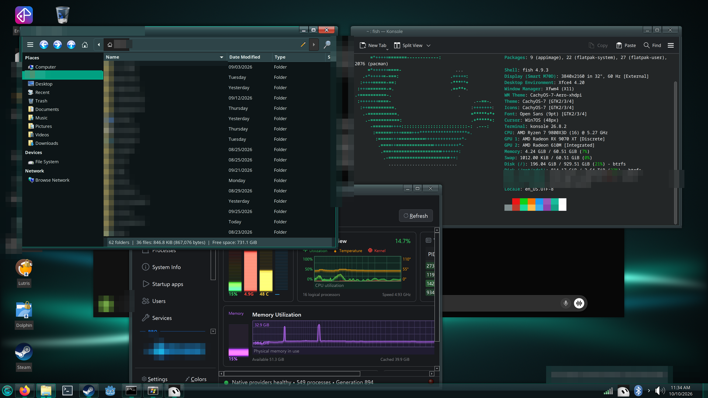
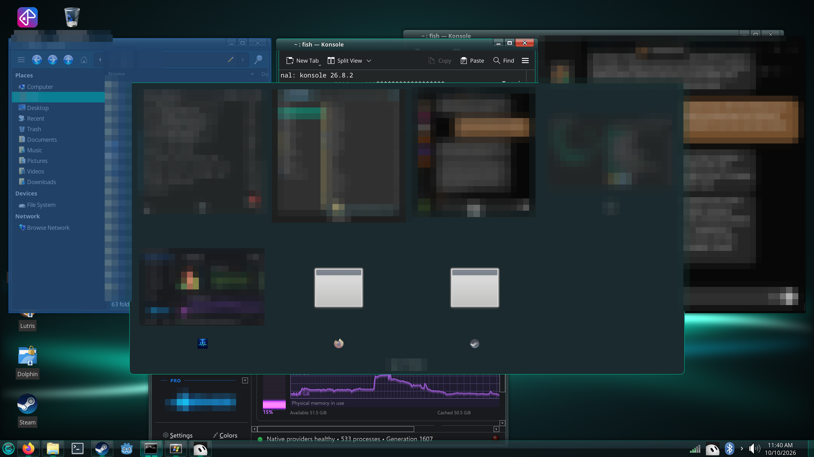
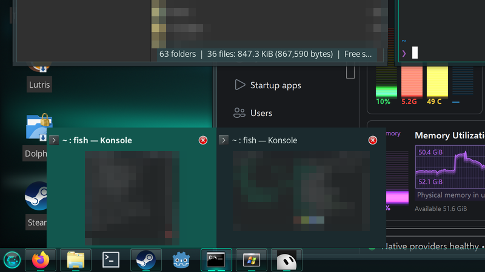
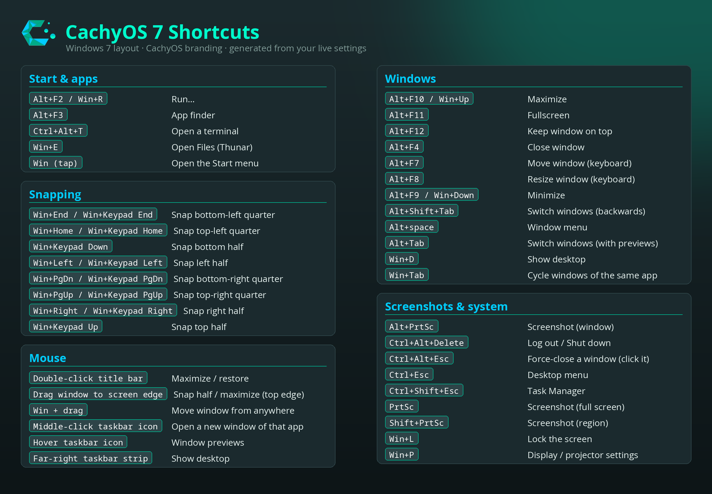
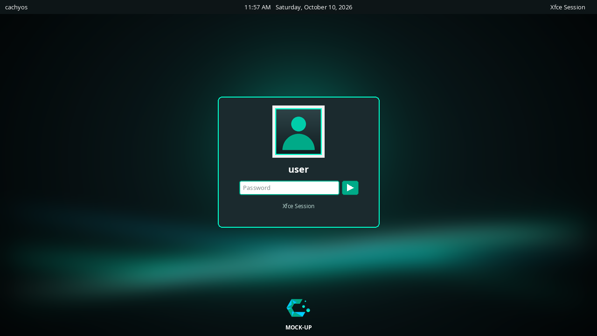
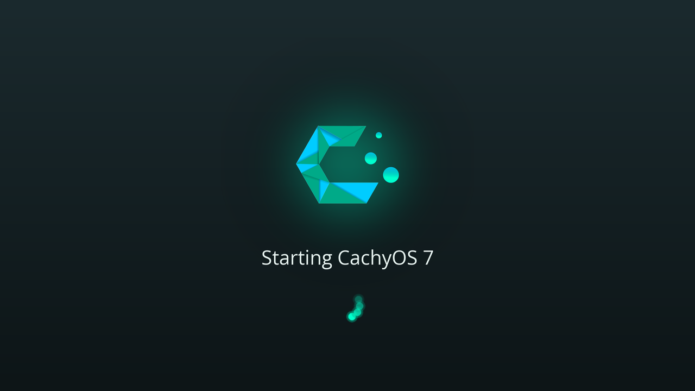

# CachyOS 7

**A Windows 7 layout with CachyOS colours, for the Xfce desktop.** You get a glass taskbar with a round Start orb, Aero-style title bars with a red close button, a two-column Start menu, Aero Snap and Win7 keyboard shortcuts. Everything is recoloured in CachyOS teal on dark slate.

> Not affiliated with CachyOS or Microsoft. It contains no Microsoft artwork, sounds or fonts.



| Alt+Tab | Taskbar previews |
|---|---|
|  |  |



*Personal details in the screenshots are pixelated.*

| Login screen (**mock-up**, not a screenshot) | Boot splash (preview render) |
|---|---|
|  |  |

## Features
- **Taskbar (superbar):** dark slate glass with a teal edge. Start orb on the left. Pinned and running apps share one dock, with grouping, window previews on hover, a window count and middle-click for a new window. Then the tray, volume, a two-line clock and a Show Desktop strip at the far right.
- **Start menu:** Whisker Menu in a Win7 layout. Favourites on the left, categories on the right, search box, and Lock / Restart / Shut down buttons.
- **Windows:** original Aero-style xfwm4 theme in **1x and 2x (HiDPI)** variants. Minimize / maximize / close on the right, double-click maximizes, windows open centred.
- **Aero Snap:** drag to an edge for a half or maximized window; Win+arrows; quarter tiles on Win+Home/PgUp/End/PgDn.
- **Dark GTK3/GTK4 theme:** slate surfaces, teal selections. Qt apps follow it through the gtk3 platform theme.
- **CachyOS-7 icons:** extend the B00merang Windows-7 set. Cursors are Win7OS.
- **Original sound theme** (synthesized chimes): login, logout, errors, messages, devices, trash, volume, bell.
- **Teal glass notifications** in the bottom-right corner.
- **Wallpapers:** 4K, 1440p and 1080p, plus a blurred login variant.
- **Optional:** a LightDM login screen (`--with-login`) and a plymouth boot splash (`--with-splash`).

## Requirements
- Xfce 4.18+ on X11, `xfce4-docklike-plugin`, `xfce4-whiskermenu-plugin`, `xfce4-pulseaudio-plugin`, `xfce4-notifyd`.
- Python 3 with Pillow and numpy, plus `rsvg-convert` (librsvg).
- Fonts: Open Sans and Noto Sans Mono are recommended; it falls back to Sans/Monospace. No fonts are bundled.
- Arch/CachyOS: `install.sh` offers to install all of the above. Other distros: it prints the package names.

## Install
```bash
git clone <this repo> cachyos7 && cd cachyos7
./install.sh --dry-run          # show what would happen
./install.sh                    # install for your user (applies live if you are in Xfce)
./install.sh --with-login --with-splash   # also the LightDM greeter and boot splash (asks before each sudo step)
```
Options: `--scale auto|1|2`, `--no-lock` (turns off the screensaver, auto-lock, blanking and sleep; by default those stay at Xfce defaults), `--logo FILE.svg|png` (use your own logo in the Start orb), `--yes`.

You can re-apply the configuration at any time with `python3 generators/cachyos7-apply [--scale 2] [--no-live]`.

## Uninstall
```bash
./uninstall.sh                  # restores the settings backup made by install.sh
./uninstall.sh --remove-login --remove-splash --remove-assets
```

## Scaling notes
- `--scale auto` picks **2x** when the largest monitor is at least 3840 px wide (4K, TVs included), or at least 2560 px wide and over 160 dpi. Otherwise it uses **1x**.
- At 2x: Xfce window scaling is 2, the xfwm4 theme is `CachyOS-7-Aero-xhdpi`, the cursor is 48 px and Qt gets `QT_SCALE_FACTOR=2`. The Qt setting is written to a marked block in `~/.xprofile` that only applies in Xfce.
- Xft DPI stays at 96, so GTK, Qt and Electron apps all come out the same size. Log out and back in after changing the scale.

## Shortcuts
| Keys | Action |
|---|---|
| Win (tap) | Start menu |
| Win+E | Files |
| Win+D | Show desktop |
| Win+L | Lock |
| Win+R / Alt+F2 | Run |
| Ctrl+Shift+Esc | Task Manager |
| Alt+Tab / Alt+Shift+Tab | Switch windows (previews) |
| Win+Tab | Cycle windows of the same app |
| Win+Left / Right | Snap half |
| Win+Up / Down | Maximize / minimize |
| Win+Home / PgUp / End / PgDn | Snap quarter |
| Alt+F4 | Close |
| PrtSc / Alt+PrtSc / Shift+PrtSc | Screenshot screen / window / region |
| Ctrl+Alt+Del | Log out / shut down |

There is a full cheat sheet in [docs/screenshots/shortcuts.png](docs/screenshots/shortcuts.png).

## Troubleshooting
- **The login screen doesn't appear after `--with-login`:** press **Ctrl+Alt+F3**, log in on the text console, run `sudo bash ~/path/to/cachyos7/scripts/login-undo.sh`, then `reboot`. This brings your previous display manager back.
- **Splash problems:** `sudo bash scripts/splash-undo.sh` restores your previous plymouth theme and boot settings.
- **Panel looks wrong after an Xfce update:** run `python3 generators/cachyos7-apply` again.
- **Qt apps are too small or too big:** log out and back in after changing the scale (`~/.xprofile` is only read at login).

## Credits and licenses
- CachyOS 7 code and original assets (Aero xfwm4 theme, orb, superbar, wallpapers, sound theme, plymouth theme, greeter theme, generators): © 2026 Ryan Norton, **GPL-3.0-or-later** (see `LICENSE`).
- Windows-7 GTK theme (base of the CachyOS-7 GTK theme): [B00merang Project](https://github.com/B00merang-Project/Windows-7), GPL-3.0 (`LICENSES/`).
- Windows-7 icon theme: [B00merang Artwork](https://github.com/B00merang-Artwork/Windows-7), a port of the Win2-7 icon theme. The upstream repository ships no LICENSE file; check its terms before redistributing (`LICENSES/`).
- Win7OS cursors: [yeyushengfan258/Win7OS-cursors](https://github.com/yeyushengfan258/Win7OS-cursors), GPL-3.0 (`LICENSES/`).
- The **CachyOS logo** is a trademark of the CachyOS project and is used here with attribution only. This project is **not affiliated with or endorsed by CachyOS**. Use `--logo` to swap it.
- Open Sans (SIL OFL) and Noto fonts are not bundled; install them from your distribution.
